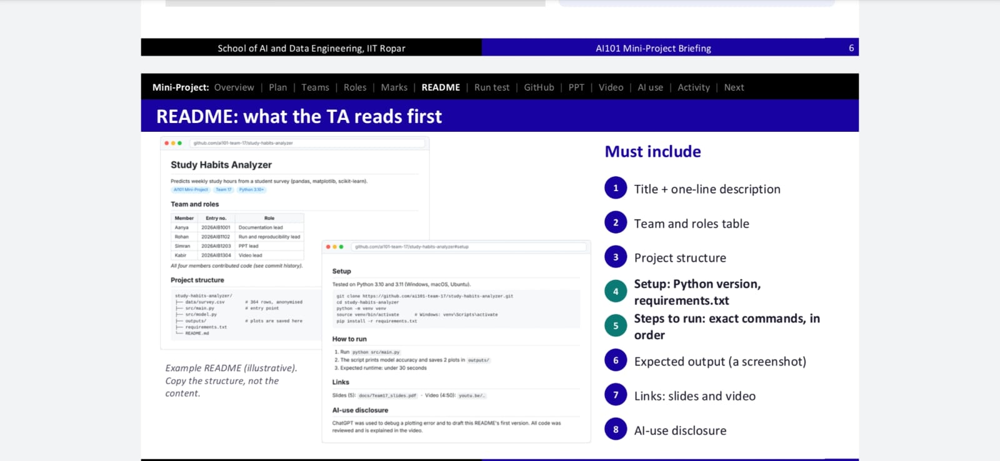
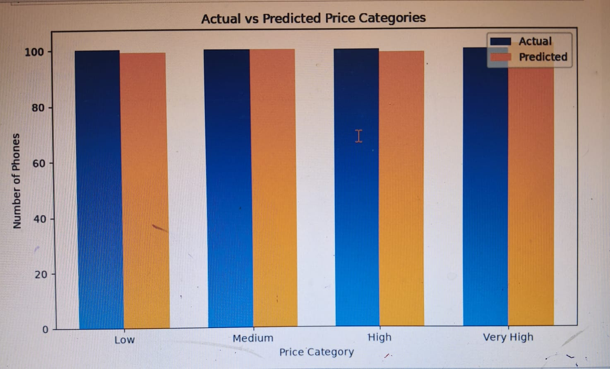

# Mobile Price Classification Using Logistic Regression

## 1\. Project objective

This project uses **Multiclass logistic Regression** to classify a mobile phone into one of four price categories using its specifications.

| `price_range` | Category |
| :---- | :---- |
| 0 | Low cost |
| 1 | Medium cost |
| 2 | High cost |
| 3 | Very high cost |

This is a **multiclass classification** problem because the target has four possible classes.

## 2\. Dataset

The dataset is stored in `data/mobile_price.csv`.

- 2,000 rows  
- 20 input features  
- 1 target column: `price_range`    
- Five missing values are present in the feature columns. They are filled using the median of the training data.


## 3\. Project folder structure

```
Mobile_Price_Logistic_Regression/
│
├── data/
│   └── mobile_price.csv
│
├── src/
│   ├── data_exploration.ipynb
│   └── data_preprocessing_training_evaluation.ipynb
│
├── README.md
└── requirements.txt
```

## 4\. Libraries used

- **Pandas:** read and explore the dataset  
- **NumPy:** numerical operations  
- **Matplotlib:** create graphs  
- **Seaborn:** create the confusion matrix heatmap  
- **Scikit-learn:** split data, scale features, train Logistic Regression and evaluate predictions


This program:

1. Reads the dataset.  
2. Separates features (`X`) and target (`y`).  
3. Splits the data into 80% training and 20% testing data.  
4. Fills missing feature values using training-set medians.  
5. Scales the features using `StandardScaler`.  
6. Trains a multiclass Logistic Regression model.  
7. Predicts the classes for the test data.  
8. Calculates evaluation metrics and displays a confusion matrix.  


## 6\. Understanding the model

### Features (`X`)

The 20 phone specifications, such as:

- `battery_power`  
- `ram`  
- `px_height`  
- `px_width`  
- `mobile_wt`  
- `int_memory`  
- `four_g`  
- `wifi`

### Target (`y`)

`price_range` is the value the model learns to predict.

### Train-test split

- 80% of the data is used for training.  
- 20% is used for testing.  
- `random_state=42` makes the split reproducible.  
- `stratify=y` maintains approximately the same class proportions in both sets.

### Missing values

The median of each feature is calculated from the training data and used to fill missing values in both training and testing data.

### Feature scaling

`StandardScaler` brings numerical features to a comparable scale. It is fitted on training data only, and the same scaler is used to transform testing data.

### Logistic Regression

`LogisticRegression(max_iter=1000)` learns to assign each phone to one of the four classes. The model predicts the class with the highest estimated probability.

## 7\. Model evaluation

The project calculates:

- **Accuracy:** proportion of all test predictions that are correct.  
- **Precision:** among predictions for a class, the proportion that truly belong to that class.  
- **Recall:** among actual examples of a class, the proportion correctly identified.  
- **F1-score:** harmonic mean of precision and recall.  
- **Classification report:** shows precision, recall, F1-score and support for every class.  
- **Confusion matrix:** compares actual classes (rows) with predicted classes (columns).


The program reports **macro average** and **weighted average**:

- Macro average gives each class equal importance.  
- Weighted average accounts for the number of test examples in each class.

- ##Results



